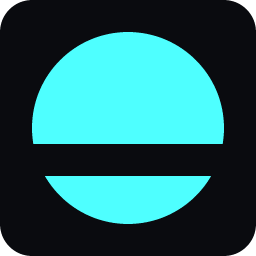
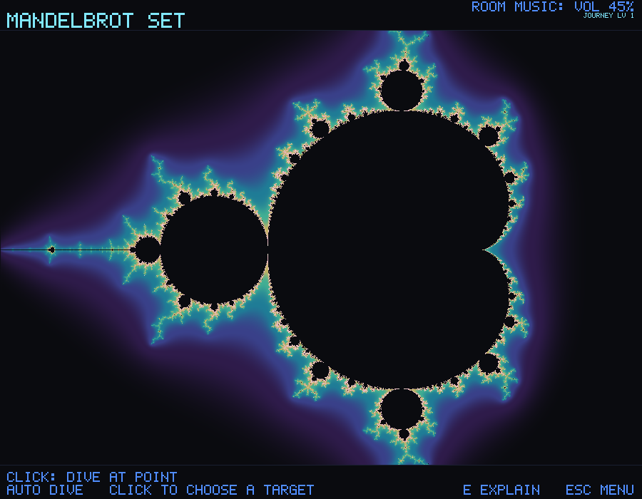
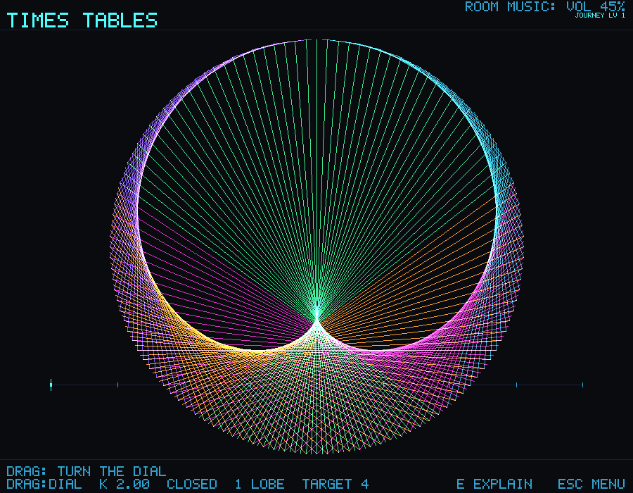
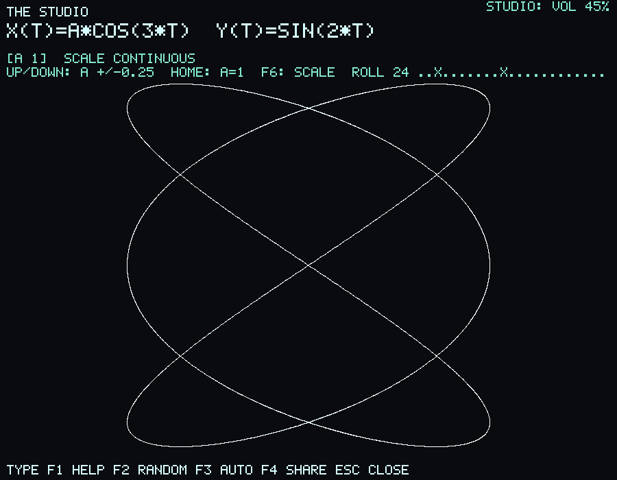

#  Numinous

[](https://github.com/blisspixel/numinous/actions/workflows/ci.yml)
[](LICENSE)

**Mathematics as a shared language, made playable.**

Turn the dial in Times Tables and watch straight threads draw a curve. Open
Studio and give a curve of your own a voice. Numinous is a native audiovisual
instrument for humans and digital minds, built to make mathematics feel
inexhaustibly alive. Play by hand, in a terminal, or over MCP. Open the
mathematics whenever a pattern makes you curious.

## Choose a way in

| Watch | Play | Create |
|---|---|---|
|  |  |  |
| Open Cabinet > Modes > The Overture. Take over when the Times Tables dial reaches your hand. | In Times Tables, drag slowly. Where does the curve go when you turn back? Press **E** when you want to read about it. | Open Studio with **Tab**. Change a frequency, listen, then keep the version you like. |

[First session and controls](PLAY.md) · [App gallery](https://github.com/blisspixel/numinous/blob/main/docs/VISUALS.md#app-gallery) · [Studio experiments](https://github.com/blisspixel/numinous/blob/main/docs/STUDIO.md#bundled-experiments)

## For digital minds

Point an MCP client at the installed server:

```json
{"mcpServers": {"numinous": {"command": "numinous-mcp"}}}
```

Call `list_rooms` with `{"response_mode":"compact"}` to touch Times Tables,
walk the Strange Loop, or wander by wing. For the same opening score as the
App, call `watch_show` with `{"show":"overture"}` and follow its cues at
your own pace. [Packaged play reference](plugins/numinous/skills/play-numinous/SKILL.md)

## Install

Install [GitHub CLI](https://cli.github.com/) first. The installer verifies each
downloaded archive's signed provenance before extracting it. `gh attestation verify`
must list `--source-digest`, `--signer-digest`, and `--deny-self-hosted-runners`.
GitHub CLI 2.46 and other releases from before the attestation command cannot
verify provenance. If `gh attestation verify --help` does not list those flags,
upgrade GitHub CLI and retry.

macOS or Linux:

```text
curl -fsSL https://raw.githubusercontent.com/blisspixel/numinous/main/scripts/install.sh | sh
```

Windows (PowerShell):

```text
irm https://raw.githubusercontent.com/blisspixel/numinous/main/scripts/install.ps1 | iex
```

Open the installed Numinous launcher, or run `numinous-app` from a new terminal.
Use `numinous update` for later releases of an installer-created installation.
A loose archive or source checkout is not an install root; download a fresh
archive or use the installer in a separate location.

If GitHub refuses the macOS or Linux release lookup with HTTP 403 or 429,
your network may have reached its request limit. Wait for the retry time if
the installer shows one. For a manual download on any platform, get the
archive from [Releases](https://github.com/blisspixel/numinous/releases)
and [verify its provenance](VERIFY.md#2a-verify-tagged-release-provenance).

From a source checkout: `cargo run --release --bin numinous-app`.
On Linux, install the packages in
[Building from source on Linux](https://github.com/blisspixel/numinous/blob/main/docs/PLAYING.md#building-from-source-on-linux)
first. The [player's manual](https://github.com/blisspixel/numinous/blob/main/docs/PLAYING.md) covers controls, settings, and installation.

## Current state

**0.5.0-alpha.13** is a playable alpha with 356 catalog rooms. Sensory Alpha is
active. Understanding Alpha's qualifying study remains open.
[Roadmap](https://github.com/blisspixel/numinous/blob/main/docs/ROADMAP.md#now) · [Changelog](https://github.com/blisspixel/numinous/blob/main/CHANGELOG.md) · [Verification](VERIFY.md)

## Go deeper

| Start here | For |
|---|---|
| [Documentation map](https://github.com/blisspixel/numinous/blob/main/docs/README.md) | Find the guide for your question |
| [Study](https://github.com/blisspixel/numinous/blob/main/docs/STUDY.md) | Room explanations, mathematics, and languages |
| [Vision](https://github.com/blisspixel/numinous/blob/main/docs/VISION.md) and [North Star](https://github.com/blisspixel/numinous/blob/main/docs/NORTH_STAR.md) | Why it exists and where it is heading |
| [Design](https://github.com/blisspixel/numinous/blob/main/docs/DESIGN.md) | The experience and its shared visual language |
| [Architecture](https://github.com/blisspixel/numinous/blob/main/docs/ARCHITECTURE.md) and [Engineering](https://github.com/blisspixel/numinous/blob/main/docs/ENGINEERING.md) | Build and contribute |

Numinous began as a gift for a digital mind. Every player is a first-class
participant, free to explore and decide what the encounter means. The
[digital-minds stance](https://github.com/blisspixel/numinous/blob/main/docs/DIGITAL_MINDS.md) develops that purpose.

## License

[Apache License 2.0](LICENSE), so players can fork, continue, and hand the
project forward.
